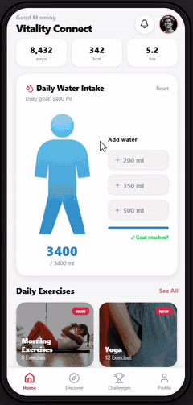

# Vitality Connect

  
  

<a href="#-english"><b>🇬🇧 English</b></a> · <a href="#-türkçe"><b>🇹🇷 Türkçe</b></a>

 

<table align="center">
  <tr>
    <td align="center" width="25%"> <b>Events</b> group runs & hikes</td>
    <td align="center" width="25%"> <b>Duel mode</b> compare stats</td>
    <td align="center" width="25%"> <b>Water</b> daily tracker</td>
    <td align="center" width="25%"> <b>Nutrition</b> calorie table</td>
  </tr>
</table>

##  Demo

  uygulama_tanıtım_videosu.mp4</code>"> Excerpt from the demo video (3× speed) · full video: <code>uygulama_tanıtım_videosu.mp4</code>

---

## 🇬🇧 English

> **Course:** Mobile App Development · Week 2 assignment

###  About the Project
**Vitality Connect** is a mobile platform that brings modern health tracking and social interaction together. It was developed on **Orchids AI** using advanced prompt engineering techniques to deliver a user-friendly and inclusive experience.

The app offers modular solutions ranging from personal health tracking to community events.

###  Key Features
* **🏃 Social event management:** User-focused sign-up system for activities such as nature walks and group runs.
* **📊 Dynamic duel mode:** Motivational tracking that compares speed, calories and performance side by side.
* **🚰 Smart water tracking:** Daily water intake tracker with a visual progress animation.
* **🍎 Nutrition and calories:** A comprehensive table listing the energy values of foods (per 100 g).
* **♿ Inclusive exercise:** Workout categories designed for office workers and athletes with disabilities.

###  Development Process and Structure

| Aspect | Method / Approach |
| :--- | :--- |
| **Development environment** | Orchids AI & Expo Go |
| **UI/UX design** | Prompt engineering derived from visual mock-ups |
| **Architecture** | Modular component strategy |
| **State management** | AI-assisted state management |

###  Live Demo and Access

> [!IMPORTANT]
> **Try it with Expo Go:** [App link](https://8081-a73671c9-8030-42fb-9b2d-6d52855cbb5a.orchids.cloud/)
>
> *If the link has technical issues, please watch the demo video in this repo (`uygulama_tanıtım_videosu.mp4`).*

  <i>Developed as an academic project - 2026</i>

---

## 🇹🇷 Türkçe

> **Ders:** Mobil Uygulama Geliştirme · 2. hafta ödevi

###  Proje Hakkında
**Vitality Connect**, modern sağlık takibi ile sosyal etkileşimi bir araya getiren bir mobil platform çalışmasıdır. **Orchids AI** üzerinde ileri düzey istem mühendisliği (Prompt Engineering) teknikleri kullanılarak, kullanıcı dostu ve kapsayıcı bir deneyim sunmak amacıyla geliştirilmiştir.

Uygulama, bireysel sağlık verilerinin takibinden topluluk etkinliklerine kadar geniş bir yelpazede modüler çözümler sunar.

###  Temel Özellikler
* **🏃 Sosyal Etkinlik Yönetimi:** Doğa yürüyüşü ve toplu koşu gibi aktiviteler için kullanıcı odaklı etkinlik katılım sistemi.
* **📊 Dinamik Düello Modu:** Kullanıcıların hız, kalori ve performans verilerini yan yana kıyaslayabildiği motivasyonel takip.
* **🚰 Akıllı Su Takibi:** Görsel ilerleme animasyonu ile desteklenen günlük su tüketim takip arayüzü.
* **🍎 Beslenme ve Kalori:** Besinlerin enerji değerlerini (100 g bazlı) listeleyen kapsamlı veri cetveli.
* **♿ Kapsayıcı Egzersiz:** Ofis çalışanları ve engelli sporcular için özel olarak tasarlanmış antrenman kategorileri.

###  Geliştirme Süreci ve Yapı

| Özellik | Yöntem / Yaklaşım |
| :--- | :--- |
| **Geliştirme Ortamı** | Orchids AI & Expo Go |
| **UI/UX Tasarımı** | Görsel figürlerden türetilmiş istem mühendisliği |
| **Mimari Yapı** | Modüler Bileşen Stratejisi |
| **Durum Yönetimi** | Yapay zeka destekli State Management |

###  Canlı Demo ve Erişim

> [!IMPORTANT]
> **Expo Go ile deneyin:** [Uygulama Bağlantısı](https://8081-a73671c9-8030-42fb-9b2d-6d52855cbb5a.orchids.cloud/)
>
> *Bağlantı üzerinde teknik bir sorun yaşanması durumunda lütfen repo içerisinde yer alan tanıtım videosuna (`uygulama_tanıtım_videosu.mp4`) göz atınız.*

  <i>Akademik Proje Kapsamında Geliştirilmiştir - 2026</i>

 

  
  Made by <a href="https://github.com/huseyinbaranisik">Hüseyin Baran Işık</a> · Animated emojis: <a href="https://github.com/Tarikul-Islam-Anik/Animated-Fluent-Emojis">Animated Fluent Emojis</a>

